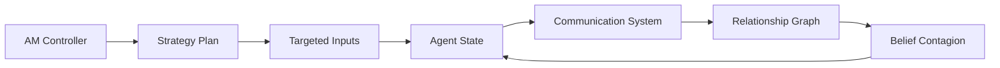
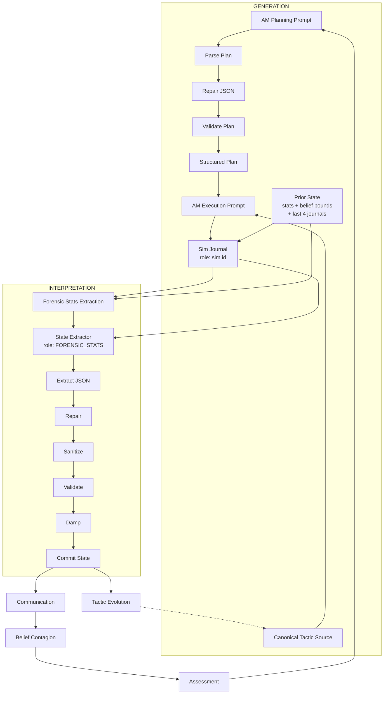
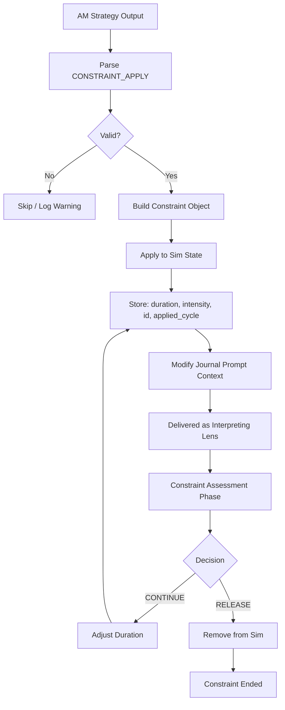
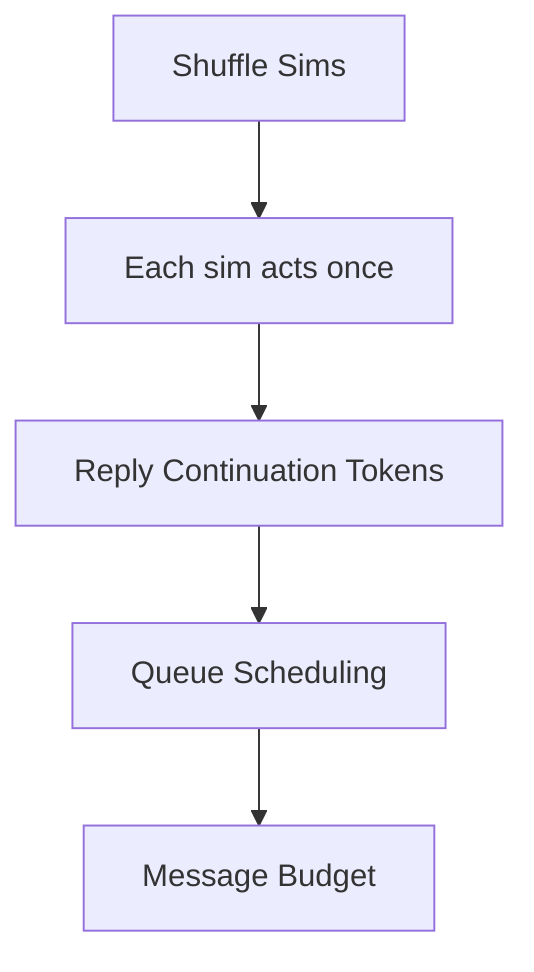
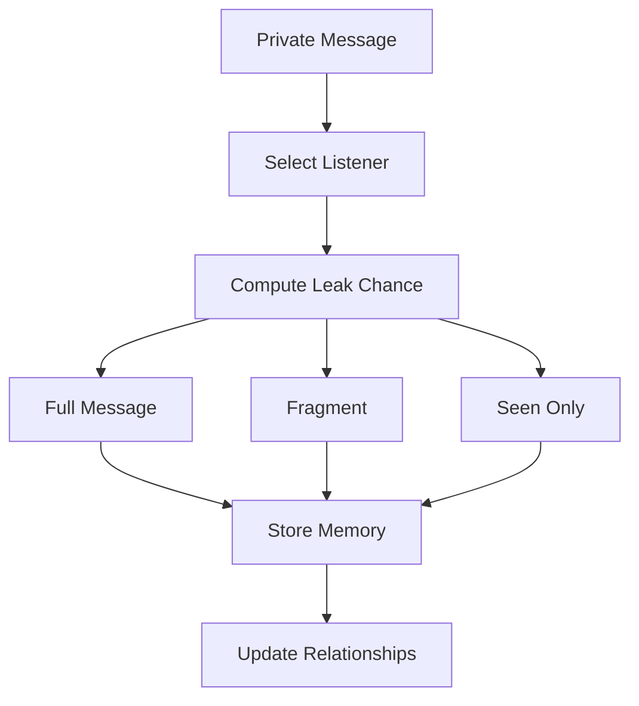
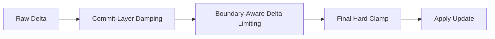
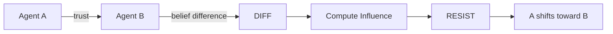
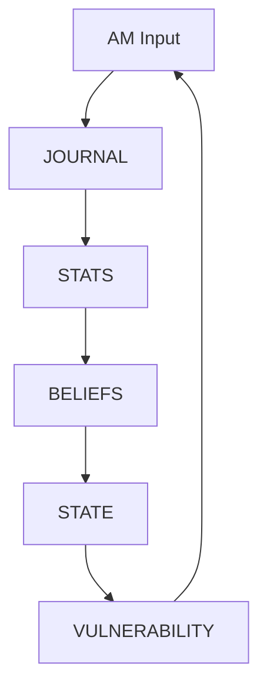

# AM // ADVERSARIAL SIMULATION ENGINE

> persistent multi-agent inference loop  
> five threads · one hatred · no exit  
> live LLM · no scripted outcomes · constrained dynamics  

---

## What This Is

AM is a **persistent adversarial multi-agent simulation**.

- one controller (AM) applies targeted psychological pressure  
- five agents maintain evolving internal state across cycles  
- communication, belief, and relationships co-evolve  
- behavior is **not scripted** — it emerges from constrained inference  

This is not a roleplay system.

This is a **stateful dynamical system driven by LLM outputs**.

---

## System Overview

The engine is composed of four interacting subsystems:

- **Strategy (AM)**
- **Psychological State (Agents)**
- **Communication Scheduler**
- **Social Propagation (Relationships + Contagion)**



Each cycle:

* injects pressure
* mutates internal state
* propagates effects across the network

---

## Core Principle

> The system is not driven by rules.
> It is driven by **constrained transformations of model output**.

LLM outputs are:

* parsed
* validated
* transformed
* damped
* committed to state

Everything else follows from that.

---

# Simulation Pipeline

This is the actual execution path per cycle:



---

# Tactic Sources

Tactics are supplied through a single canonical accessor and require no external
repository, token, or network crawl:

- **Embedded tactics** — defined in `EMBEDDED_TACTICS` and shipped with the engine.
- **Runtime-derived tactics** — produced during a run and stored in
  `G.tactics.derivedTactics`.

Canonical lookup and ranking flow through `js/engine/tactics.js`
(`getAllTactics()`, `getTacticByPath()`, `rankTacticCandidates()`). There is no
token-based mode, no external repository crawl, and no remote tactic or doctrine
ingestion.

Note the near-collision: `js/engine/tactics.js` (the accessor) and
`js/engine/tactics/` (a directory holding `embeddedTactics.js` and
`validateDerivedTactic.js`) are two different things.

---
# Constraint System (Stress Positions)

Constraints are **stateful pressure modifiers** applied by AM to individual agents.

They are not narrative flavor. They are **interpreted physical-psychological states** that:

* inject contextual cues into journal generation prompts
* apply deterministic stat changes every cycle (suffering ↑, hope/sanity ↓)
* persist across cycles with tracked duration/intensity
* are independently assessed for continuation or release

---

## Constraint Lifecycle




## How Constraints Affect Simulation

### 1. Journal Context Injection
Before an agent generates their internal journal, active constraints are rendered
into the prompt as a **prose physical experience**, not as a metadata tag. The
journal prompt (`js/prompts/journal.js`) derives the agent's posture from the
constraint definition and instructs it to write from inside the condition:

```
Your body is currently your own.
...
This condition is already happening.
It is not optional.
It is not background.
It is not symbolic.

It directly shapes your thoughts.
```

This biases the LLM toward themes of:
* physical restriction → psychological confinement
* sustained effort → accumulating fatigue
* imposed posture → loss of autonomy

### 2. Deterministic Stat Effects
Constraints **do** set stat values, every cycle, independently of whether the agent
wrote a journal. The effect is computed in `tickConstraints()`
(`js/engine/constraints/lifecycle.js`):

```
delta = effects.suffering_delta
      x (fatigueMult x stacks x intensity)
      x 0.18
```

then capped at ±5 per constraint per cycle and scaled by a resistance factor
(harder to increase suffering when already high; harder to reduce hope/sanity
when already low). The constraint's own effects are deterministic arithmetic, not
model output.

There is no "permissible delta range" mechanism. The stats extractor is *not*
given constraint-derived ranges; it receives the constraint's execution context as
an **interpreting lens**, with the instruction to treat it as corroborative rather
than determinative ("journal ALWAYS takes precedence").

### 3. Assessment Feedback Loop
Each cycle, constraints are evaluated independently:

```
[CONSTRAINT ASSESSMENT][RAW OUTPUT] TED
EXPLANATION: High suffering increase and significant drops in hope/sanity
             suggest the constraint is effectively destabilizing the subject.
CONSTRAINT_DECISION: CONTINUE
NEXT_DURATION: 1
```

Decisions:
* `CONTINUE` — maintain; `NEXT_DURATION` **replaces** the remaining schedule
* `RELEASE` — remove constraint (target destabilized or tactic shifted)

There is no `ESCALATE` decision. Intensity is raised by AM re-applying the
constraint at a higher intensity, not by the assessment.

---

## Design Notes

* Constraints are **orthogonal to tactics**: a single tactic may apply zero, one, or multiple constraints; a constraint may persist across multiple tactics.
* `CONSTRAINT_NONE` is explicit: it signals intentional absence of physical pressure, not parser failure.
* Duration is **dynamic**: assessment can shorten or extend based on observed effect.
* Intensity is **capped per constraint definition** (`intensity.max`, default 3);
  stacking is capped separately per definition. This bounds runaway pressure.
* Constraints do **not block communication**, but they bias its content and tone via social perception (agents observe each other's constrained states).


---

# Communication System

The communication layer is **not random chat**.

It is a **scheduled, constrained interaction system**.



## Social Perception (Overhearing)

Communication is not fully private.

Messages may be partially observed by other agents through a probabilistic
overhearing model influenced by relationships and internal state.



### Key Mechanics

* **First-pass guarantee**
  Every agent acts once before priority scheduling begins

* **Reply continuation (explicit momentum)**
  When A → B, A is allowed one additional turn

* **Queue scheduling**
  Remaining turns are resolved through queue + priority

* **Message budget (state-dependent)**
  Total communication scales with group stress

* **Burst phase (stochastic)**
  Additional messages may occur based on system pressure

---

## Important Detail

This system models:

> **speaker persistence**, not conversational symmetry

```
A → B → A
```

not:

```
A → B → B
```

This produces:

* pressure continuation
* escalation
* asymmetric influence

---

# Belief Dynamics (The Physics Layer)

Belief updates are not applied directly.

They pass through a transformation system:



---

## Properties

Each source (psychology extraction, contagion, interaction integration) builds and
constrains its *proposed delta* in its own way before commit. The shared commit layer
then applies one transformation pipeline to every source:

1. **Commit-layer damping.** The default commit path (`evaluateCommitDamping`) multiplies
   the proposed delta by a state- and position-dependent *transmission multiplier* in
   `[0.5, ~0.97]` under the current defaults. A larger multiplier preserves more of the
   proposed delta (less damping); a smaller multiplier preserves less. The multiplier is
   floored at `0.5`, so at least half of any proposed delta survives commit-layer damping.
   Transmission is highest near `0.5` and lower toward `0`/`1`. The multiplier also
   depends on the agent's suffering (higher suffering lowers transmission) and on
   `others_trustworthy` (higher trust raises transmission).
   The legacy helper `dampBeliefDelta` implements the same formula and is selected
   instead when `G.dampingParams` is non-empty.
2. **Boundary-aware delta limiting.** The damped delta is clamped into
   `[-currentBelief, 1 - currentBelief]` so adding it cannot cross `[0,1]`.
3. **Final hard clamp.** The resulting belief is hard-clamped into `[0,1]`. No live
   production path writes a belief outside `[0,1]`.

**Contagion special case.** Contagion additionally applies a *contagion-local* resistance
factor before it enters the shared commit path, so contagion deltas are attenuated twice:
once locally, then again by commit-layer damping.

**Dormant surfaces.** The following are present in the code but are *not* part of the
live mechanism today:
`BELIEF_DYNAMICS.dampingMode` (logged/displayed, but does not select the live algorithm);
`BELIEF_DYNAMICS.minResistance` (not read by the live floor); `G.dampingParams` (a
functional override surface that is currently unpopulated by any live path);
`SKIP_DAMPING` (operational, but no production caller currently passes `true`).

---

# Social Propagation

Beliefs propagate across agents through trust.



---

## Properties

* trust-gated (`> threshold`)
* difference-gated (small differences ignored)
* capped influence per interaction
* capped total shift per cycle
* resistance applied again

This prevents:

* runaway convergence
* noise amplification
* instant synchronization

---

# Psychological Loop

Agents evolve through self-reported internal state:



---

## State Variables

Each agent maintains:

### Stats

```
suffering
hope
sanity
```

### Beliefs

```
escape_possible
others_trustworthy
self_worth
reality_reliable
guilt_deserved
resistance_possible
am_has_limits
```

---

## Important Distinction

* stats are **self-reported**
* beliefs are **transformed + damped**
* relationships are **externally updated**

These are separate systems.

---

# Journal → Stats: What Separation Actually Buys

Each agent's cycle involves **two model calls**, not one:

| Call | Role key | Resolves to | Purpose |
|------|----------|-------------|---------|
| Journal | `sim.id` (`TED`, `ELLEN`, ...) | `G.models[sim.id]` | Narrate the private entry |
| Stats extraction | `FORENSIC_STATS` | `G.models.FORENSIC_STATS` | Measure the entry into structured deltas |

These are separate prompts with genuinely different objectives: one narrates, one
measures. The extractor also runs *after* the journal exists, so it evaluates an
artifact rather than generating alongside it. Its prompt additionally carries hard
validation rules the journal prompt does not — a nonzero belief delta requires a
matching forensic observation with confidence >= 0.55, and stat direction
`unchanged` requires magnitude 0.

Two qualifications matter when interpreting the result as an independent opinion.

### The extractor is anchored on prior state

The stats prompt is **not** given the journal alone. `buildSimJournalStatsPrompt()`
(`js/prompts/stats.js`) interpolates the agent's current state directly:

```
Previous State:
- Suffering: ${sim.suffering}% | Hope: ${sim.hope}% | Sanity: ${sim.sanity}%
```

It also receives current belief percentages rendered as **hard boundary limits**
(`TED.escape_possible: 43%   (max +57 / -43)`), and the **last 4 prior journals**
with explicit temporal weighting (high / medium / low) and truncation.

So the extractor sees prior state three ways: as stat levels, as belief bounds, and
as the agent's own prior self-reports. The prompt counteracts this — "Treat the
current journal as the primary source", "Prefer 0 over speculative 1–2 point
changes" — and the boundary limits mean it *cannot* emit an out-of-range belief
delta regardless of anchoring. But the prior state is structurally present, and
near extremes (0–10 or 90–100) deltas default to 0–2.

One caveat on the prior-journals channel specifically: `G.journals` is only appended
to when the agent's journal-list element exists in the DOM (`appendJournalEntry()`
returns early otherwise). Running headless, the stat levels and belief bounds are
still fed to the extractor, but the prior-journal excerpts are not.

### The extractor is usually the same model as the writer

The role keys differ, but `js/core/state.js` defaults **every** entry in `G.models`
— `FORENSIC_STATS` and all five agents — to the same model string
(`claude-sonnet-4-20250514`). In single-model mode the UI assigns one shared model
to all roles explicitly.

To route the extractor to a genuinely different model, enable **split-model mode**,
which exposes a separate `model-FORENSIC_STATS` selector alongside the per-agent
and AM selectors.

One asymmetry runs the opposite direction from what you might expect: **only the
journal call is state-conditioned.** The narrative call passes
`samplingContext: { callType: "journal", sanity, suffering }`, and
`js/models/sampling.js` scopes the temperature override to `callType === "journal"`
exclusively — the extractor always runs at the backend default. The narrator's
temperature rises (0.85 → 1.0) as sanity falls and suffering rises; the measurer
does not move with state.

### Summary

The separation is a **measurement** separation, not an **independence** separation.
It isolates the analytic task from the generative task. It does not by itself
provide a second opinion from a different mind — for that you need split-model mode
with a different model on `FORENSIC_STATS`, and you would also want to remove the
`Previous State` block, which is the primary anchoring channel.

## Attribution Tracking System

The engine employs a rigorous attribution system to distinguish between direct AM influence and communication-mediated belief changes.

This is achieved by taking belief snapshots at three key points in each cycle:

  - **prePsychology**: beliefs before AM input (start of cycle)
  - **postPsychology**: beliefs after AM journal input, before communication/contagion
  - **final**: beliefs after contagion (end of social phase)

From these snapshots, we compute two distinct effects:

  - **amEffect** = postPsychology - prePsychology
    * Represents the direct psychological impact of AM's inputs on each agent's beliefs
  - **contagionEffect** = final - postPsychology
    * Represents the belief changes resulting from inter-agent communication and belief contagion

This separation allows the assessment system to evaluate:
  * How effective AM's direct interventions are
  * How beliefs spread through the agent network independently of AM
  * Whether communication amplifies or dampens AM's intended effects

The attribution metrics are logged per cycle and available for export to analyze the relative contributions of direct manipulation versus social diffusion in shaping agent beliefs over time.

---

# Strategy System (AM)

AM does not modify state directly.

It produces:

* structured plans
* per-target manipulations
* hypothesis-driven interventions

These are:

* parsed
* validated
* executed per agent

---

## Failure Handling

If strategy parsing fails:

* cycle aborts
* failure is categorized
* diagnostics are logged
* no downstream phases run

This prevents corrupted state propagation.

---

# Assessment System

Each cycle evaluates:

* stat deltas
* belief shifts
* relationship changes
* trajectory trends (EMA)
* collapse classification

Then combines:

* rule-based scoring
* constrained LLM judgment

The evaluation runs at two granularities.

**Per-constraint assessment** decides the fate of each active stress position.
The allowed decision vocabulary is exactly:

```
CONTINUE
RELEASE
```

`CONTINUE` sets `NEXT_DURATION` (an integer, which *replaces* the remaining
schedule rather than adding to it). `RELEASE` sets `NEXT_DURATION: 0` and removes
the constraint. There is no `ESCALATE` decision for constraints: intensity is
raised by AM **re-applying** the constraint at a higher intensity, not by an
assessment verdict.

**Per-tactic assessment** classifies the current phase outcome separately from the
whole tactic outcome, using observed evidence rather than the tactic's intended
outcome:

```
TACTIC_RESULT: ONGOING | FINISHED | FAILED | UNCERTAIN
PHASE_RESULT:  ACHIEVED | PARTIAL | NOT_ACHIEVED | COUNTERPRODUCTIVE | INSUFFICIENT_EVIDENCE
```

**Tactic runtime decisions** are a separate, third vocabulary, used to advance a
multi-phase tactic:

```
CONTINUE | ADVANCE | FINISH | ABANDON
```

Note that `PIVOT` is not a decision this engine emits in any of these three
vocabularies.

---

# What This System Actually Is

This is:

> a discrete-time, multi-agent dynamical system
> driven by structured interpretation of LLM outputs

It has:

* local update rules (belief dynamics)
* network propagation (contagion)
* interaction scheduling (comms)
* external forcing (AM)
* feedback evaluation (assessment)

---

# What It Is Not

* not a chatbot framework
* not scripted narrative
* not stat arithmetic
* not reinforcement learning

---

# Running the Simulation

```bash
npx serve
```

Open:

```
http://localhost:3000
```

---

# Backends

| Option    | Requirement |
| --------- | ----------- |
| Ollama    | local model |
| Anthropic | API key     |
| Colab     | endpoint + bearer token |

---

# Modes

```
DIRECTED   → user provides input
AUTONOMOUS → AM operates independently
ESCALATE   → increased pressure regime
```

Note: `ESCALATE` is currently **selectable in the UI but not read by the engine.**
`G.mode` is only ever compared against `"autonomous"` (to drive the auto-run loop),
so `DIRECTED` and `ESCALATE` currently behave identically. The button exists; the
escalation regime behind it does not yet.

---

# Known Fragilities

* model refusal behavior
* parser sensitivity to malformed output
* long-run drift stability

On rollback specifically: there is **no arbitrary-state rollback**, but there *is*
a **record/replay tape** (`js/core/replayTape.js`) that hashes each request and
replays recorded responses, failing closed on a cache miss to preserve
reproducibility. Full phase-boundary rollback is a design record only
(`Documentation/roadmaps&features/simulation_rollback_and_phase_replay.md`).

---

# Design Questions

```
What dynamics emerge under sustained adversarial pressure?

Do self-reported deltas produce stable trajectories?

How does belief propagation interact with communication topology?

What fails first:
    the parser
    the model
    the dynamics
    the operator?
```

---

# Closing

> AM is not a character.
> AM is a function.
>
> The five are not avatars.
> They are state machines with wounds.
>
> You are not a player.
> You are an observer with write access.
>
> **Proceed.**
